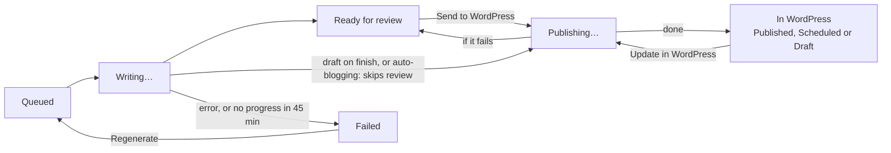

# TriCity Writer User Manual

<!-- Written for end users. Labels, defaults and limits are taken from apps/web, packages/core and the
     connector plugin: update this file when they change. -->

TriCity Writer writes SEO articles with AI and publishes them to your self-hosted WordPress sites. This manual covers every feature in version 1.0 and how each one works.

Contents:

1. [Getting started](#getting-started)
2. [Connecting a WordPress site](#connecting-a-wordpress-site)
3. [Writing an article](#writing-an-article)
4. [Reviewing and publishing](#reviewing-and-publishing)
5. [Article statuses](#article-statuses)
6. [Templates and site prompts](#templates-and-site-prompts)
7. [Auto-blogging](#auto-blogging)
8. [SEO plugins](#seo-plugins)
9. [Workspaces and teams](#workspaces-and-teams)
10. [AI models, keys and usage](#ai-models-keys-and-usage)
11. [AI assistants (MCP)](#ai-assistants-mcp)
12. [Your account](#your-account)
13. [Limits and troubleshooting](#limits-and-troubleshooting)

## Getting started

Every account comes with its own workspace, so you can connect a site and write right after signing up.

### Create an account

1. Open your TriCity Writer address and choose **Get started** (or **Create your workspace**).
2. Enter your name, email and a password of at least 8 characters, then choose **Create account**.
3. If your server sends email, you see **Check your inbox**. Open the confirmation link within 24 hours. It signs you in and takes you to your workspace.
4. No email? Check spam, or choose **Send the link again**.

Some servers are **invite-only**. There, only the very first account can sign up freely. Everyone else needs an invitation link from a workspace owner or admin (see [Workspaces and teams](#workspaces-and-teams)), and must sign up with the invited email address. The sign-up page says "New accounts are by invitation" when this applies.

### Sign in

Choose **Sign in** and enter your email and password. If you never confirmed your email, TriCity Writer sends a fresh confirmation link instead of signing you in.

### Forgot your password

1. On the sign-in page, choose **Forgot your password?**
2. Enter your email and choose **Send reset link**. The link works for one hour.
3. Open it, enter a new password twice, and choose **Save password**.

If your server doesn't send email yet, the reset link is written to the server's log. Ask your administrator for it.

### Find your way around

The menu on the left has four pages:

| Page | What you do there |
| --- | --- |
| Sites | Connect WordPress sites, write articles, set site prompts and auto-blogging |
| Articles | Every article in the workspace, with its status |
| Templates | Content and design templates for new articles |
| Settings | Workspace name, members, AI keys, assistant (MCP) keys, usage and your account |

If you belong to more than one workspace, a workspace picker sits above the menu. **Sign out** is at the bottom. On a phone, open the menu with the button in the top bar.

## Connecting a WordPress site

A site connects through the free **TriCity Writer Connector** plugin and a one-time pairing code. You need WordPress 6.0 or later and PHP 7.4 or later.

### Pair a site

1. In TriCity Writer, open **Sites** and choose **Connect a site**.
2. Choose **Download the TriCity Writer Connector plugin**.
3. In WordPress admin, go to **Plugins → Add New → Upload Plugin**, upload the zip and activate it.
4. Open **TriCity Writer** in the WordPress admin menu. Type a **Connection name** (for example "Marketing team") and choose **Generate pairing code**.
5. Back in TriCity Writer, paste the **Site address** and the **Pairing code**, then connect. Codes work once and expire after 10 minutes.

TriCity Writer acts as the WordPress user who generated the code. Use an account that can publish posts, upload files and manage categories. An administrator account also lets the plugin receive updates (see below).

### Check a site's connection

Open a site from **Sites**. Its **Overview** tab shows a **Connection** card. Choose **Check now** to refresh it.

| Row | What it tells you |
| --- | --- |
| Status | **Connected**, **Disconnected** (WordPress rejected our token) or **Unreachable** (the site didn't answer) |
| WordPress | The site's WordPress version |
| Connector | The plugin version, plus a notice when a newer one is available |
| SEO plugin | Yoast, Rank Math, AIOSEO, or "None (we print meta tags ourselves)" |
| Last checked | When TriCity Writer last reached the site |
| Acting as | The WordPress user the connection uses |

Green or red badges under the card show what that user may do: publish posts, edit pages, upload files, manage categories and post unfiltered HTML. A red badge explains a failed publish.

### Browse a site's posts and pages

The **Posts** tab lists the site's existing WordPress posts or pages, with search and paging. Each title links to the live page.

### Rename or disconnect a site

The site's **Settings** tab holds its name and its site prompts (see [Templates and site prompts](#templates-and-site-prompts)). At the bottom, **Disconnect site** removes the site, its articles and its auto-blogging settings from TriCity Writer, and revokes the connection in WordPress. Posts already in WordPress stay as they are. Only workspace owners and admins can disconnect a site.

In WordPress, the TriCity Writer page lists every connection with who it acts as and when it was last used. **Revoke** cuts a connection off immediately.

### Keep the connector up to date

When a newer connector is available, the site card shows "Connector X available: update it in WordPress". The link opens the site's WordPress updates screen. Updates appear there like any other plugin update and install only when an administrator chooses to, or turns on auto-updates for the plugin.

The site learns where updates come from when it is paired or checked by a WordPress user who can update plugins, over HTTPS. Sites paired by an author or editor account won't see updates until an administrator's connection checks in.

## Writing an article

The **Write an article** wizard turns a topic into a complete article with a title, SEO fields, categories, tags and images in four steps. Open a site and choose **Write an article** to start.

### Step 1: Content (what to write)

| Field | What it does |
| --- | --- |
| Topic or working title | Required, 3–300 characters. For example "How to start a vegetable garden on a balcony" |
| Keywords | Comma-separated. The first one becomes the focus keyword the SEO score checks |
| Type | **Blog post** or **Page** |
| Content template | The structure, angle and tone (for example a how-to guide or a listicle). "No template" writes a general article |
| Length (words) | 300–5,000, in steps of 100. Default 1,200 |
| Extra instructions | Anything specific to this article: angle, points to cover, links to use, things to avoid |

### Step 2: Design (how it looks)

| Field | What it does |
| --- | --- |
| Design template | The visual patterns: boxes, cards, tables, a call to action. "No template" gives a clean default |
| Design instructions | For example "Use orange (#ea580c) as the accent. No call-to-action box." |

Articles are plain HTML with inline styles, so they work with any theme. Fonts and widths always stay your theme's.

### Step 3: Media (images)

| Field | What it does |
| --- | --- |
| Featured image | **Generate one** (default) or **None** |
| Images inside the article | 0–6. Default 2 |
| Image style | Added to every image prompt, for example "bright natural-light photography" or "flat vector illustration" |

Images are converted to WebP and get alt text written for them.

### Step 4: Generate

| Field | What it does |
| --- | --- |
| Writing model | The AI model that writes the text. **Default** uses the workspace's default |
| Image model | The AI model that draws the images |
| When it's done | **Let me review it first** (recommended) stops at Ready for review. **Send it straight to WordPress as a draft** publishes it as a WordPress draft when it's written |

A summary shows the topic, keywords, length, templates and images. Choose **Generate article**.

Writing usually takes one to three minutes. You can leave the page. The article appears under **Articles** and on the site's **Overview** with its live status.

Your site's **Global content instructions** and **Global design instructions** (see [Templates and site prompts](#templates-and-site-prompts)) apply to every article on top of what you choose here.

## Reviewing and publishing

Nothing reaches WordPress until you send it, unless you chose a draft in the wizard or an auto-blogging mode that publishes. Open any article from **Articles** or a site's **Overview** to review it.

### Find an article

**Articles** lists everything written by the wizard, by auto-blogging and by your AI assistants. Filter it by site (**All sites**) and by source (**Wizard**, **Auto-blogging**, **AI assistant**). Each row shows the SEO score and the status.

### Preview and edit

- **Preview** shows the article roughly as your theme will, with its images.
- **Edit HTML** switches the preview to the article's HTML. Choose **Show preview** to switch back. New images show after you save.
- **Details** holds the fields WordPress and search engines use. Change any of them and choose **Save changes**.

| Field | Guidance |
| --- | --- |
| Title | The post title |
| SEO title | Aim for 30–60 characters; a counter shows the length |
| Meta description | Aim for 120–160 characters |
| Focus keyword | The phrase the SEO score checks |
| Excerpt | The short summary themes show in lists |
| Categories | Comma-separated. Existing categories are reused; new ones are created (posts only) |
| Tags | Comma-separated (posts only) |

Saving re-checks the SEO score. Any warnings from writing (for example an image that failed, or a guarded auto-blog run saved as a draft) show above the score. The footer names the models that wrote the text and drew the images.

### The SEO score

The score runs from 0 to 100: green at 80 and above, yellow at 60–79, red below 60. Each check passed earns its points.

| Check | Points |
| --- | --- |
| Keyword appears in the title | 15 |
| Length reaches 90% of the target | 15 |
| SEO title is 30–65 characters | 10 |
| Meta description is 120–160 characters | 10 |
| Keyword appears in the meta description | 10 |
| Keyword appears in the first paragraph | 10 |
| Keyword appears in a subheading | 10 |
| Focus keyword is set | 5 |
| At least two H2 subheadings | 5 |
| Keyword density is 0.5–3% | 5 |
| Every image has alt text | 5 |

### Send it to WordPress

1. In the **Publish** card, pick **Send to WordPress as**: **Draft**, **Published** or **Scheduled**. Scheduled asks for a date and time.
2. Choose **Send to WordPress**. The status shows **Publishing…** while images upload and the post is created.
3. When it's done, the card shows the WordPress status and an **Open post ↗** link.

TriCity Writer uploads the images to your media library, sets the featured image, assigns categories and tags, and writes the SEO title, description and focus keyword (see [SEO plugins](#seo-plugins)).

### Update a published article

Edit the article and choose **Update in WordPress**. It updates the same post, and you can change its status at the same time, for example from Draft to Published. If the post was deleted in WordPress, a new one is created.

### Write it again

**Regenerate** throws away the current text and images and writes the article again with the same settings. It's available for articles that are ready, published or failed. An article already in WordPress keeps its post: the next **Update in WordPress** overwrites it.

## Article statuses

Every article shows a status badge in **Articles**, on its site and on its own page. It stops at Ready for review unless you chose to send it straight to WordPress.

A failed publish returns the article to Ready for review with the reason. An article queued for more than 6 hours is also marked failed. **Regenerate** works from Ready for review, In WordPress and Failed.

| Badge | Meaning | What you can do |
| --- | --- | --- |
| Queued | Waiting for a free writer | Wait; you can leave the page |
| Writing… | The AI is writing the text and drawing the images | Wait, usually one to three minutes |
| Ready for review | Finished, not yet in WordPress | Preview, edit, check the SEO score, send to WordPress, regenerate |
| Publishing… | Uploading images and creating or updating the post | Wait |
| Published, Scheduled or Draft in WordPress | In WordPress with that status | Open the post, edit and update it, regenerate |
| Failed | Writing didn't finish; the reason is shown | Regenerate |

## Templates and site prompts

Templates and site prompts carry your editorial rules, so every article follows them, whether you write it, auto-blogging writes it or an AI assistant asks for it. Each article combines three layers: the site's global instructions, the templates you pick, and the article's own instructions.

### Built-in templates

The **Templates** page lists these ready-made templates, marked **Built-in**:

| Kind | Template | Use it for |
| --- | --- | --- |
| Content | Standard article | A well-rounded informative article |
| Content | How-to guide | Step-by-step instructions to complete a task |
| Content | List article | A ranked or themed list of items |
| Content | Comparison | Weighing options against each other to help a decision |
| Content | Beginner's guide | Explaining a topic from first principles |
| Content | Problem and solution | Diagnosing a problem and walking through fixes |
| Design | Clean | Plain headings and paragraphs with occasional callouts |
| Design | Visual | Feature cards, alternating sections and a closing call to action |
| Design | Minimal | Typography only, no boxes or colors |

Content templates decide what to write: purpose, reader, structure and tone. Design templates decide how it looks: boxes, cards, tables and colors.

### Create your own template

1. On **Templates**, choose **New template**, or choose **Duplicate** on a built-in one to start from it.
2. Pick the **Kind** (Content or Design) and give it a **Name** by intent, for example "Product comparison". A description is optional.
3. Write the **Instructions**: start with when to use it and who the reader is, then the structure and tone.
4. Save it. Custom templates are marked **Custom** and appear in the wizard and in auto-blogging for everyone in the workspace.

Built-in templates can't be edited or deleted. Custom ones can be edited or deleted at any time; articles already written keep their text.

### Site prompts

On a site's **Settings** tab, two fields apply to every article for that site:

- **Global content instructions**: audience, voice, facts to respect, links you want used.
- **Global design instructions**: brand colors, and which patterns to use or avoid.

Choose **Save** after changing them. They apply to articles written from then on.

## Auto-blogging

Auto-blogging writes one article per scheduled run from a topic list you fill, then saves it as a WordPress draft or publishes it, depending on the mode you choose. Each site has its own settings on its **Auto-blogging** tab.

### Set it up

1. Open a site and go to the **Auto-blogging** tab.
2. In **Schedule and publishing**, set **Auto-blogging** to **On**.
3. Choose what happens **When a run finishes** (see the modes below).
4. Pick a **Schedule** preset, or **Custom…** to type your own cron pattern.
5. Check the **Time zone**. It starts as your browser's time zone, for example America/Toronto.
6. Set the article options: template, length, images and models, as in the wizard.
7. Choose **Save**.
8. Under **Topic queue**, type topics one per line and choose **Add topics**.

### Modes

| When a run finishes | What happens |
| --- | --- |
| Save as draft for review | Every article goes to WordPress as a draft. You publish it there or from TriCity Writer |
| Publish if the SEO score is high enough | Publishes when the SEO score reaches the **Minimum SEO score** (default 70). Below it, the article is saved as a draft with a note explaining why |
| Always publish | Every article is published right away |

### Schedule presets

| Preset | Runs at |
| --- | --- |
| Every day at 9:00 | 09:00 daily |
| Weekdays at 9:00 | 09:00 Monday to Friday |
| Mon, Wed, Fri at 9:00 | 09:00 three days a week |
| Every Monday at 9:00 | 09:00 weekly |
| Twice a day (9:00, 17:00) | 09:00 and 17:00 daily |

Times are in the time zone you set. A custom pattern uses standard five-field cron, for example `30 7 * * 2` for Tuesdays at 07:30.

### How a run works

1. At the scheduled time, the run takes the oldest topic in the queue.
2. It writes the article with the site's auto-blogging options, global instructions and templates.
3. It saves or publishes it according to the mode.
4. The topic leaves the queue. If writing fails, the topic is marked failed and the next run moves on.

Runs are skipped, without using up a topic, when the queue is empty or when the workspace's monthly AI allowance is used up.

### Run now, recent runs and the queue

- **Run now** starts a run immediately, even while auto-blogging is off. It needs at least one queued topic.
- **Recent runs** lists the articles auto-blogging wrote, with their status and SEO score. Open one to review, edit or update it like any other article.
- **Remove** takes a topic out of the queue before it's written.

## SEO plugins

Every published article carries its SEO title, meta description and focus keyword into whichever SEO plugin your site uses, so they show up in that plugin's own editor box. Without an SEO plugin, the connector prints the tags itself. There's nothing to set up.

| Your site uses | Where the SEO fields go |
| --- | --- |
| Yoast SEO | Yoast's SEO title, meta description and focus keyphrase |
| Rank Math | Rank Math's title, description and focus keyword |
| All in One SEO (AIOSEO) | AIOSEO's title, description and focus keyphrase |
| No SEO plugin | The connector sets the page's `<title>` and prints a `<meta name="description">` tag |

If more than one is active, Yoast is used first, then Rank Math, then AIOSEO. The site's **Overview** shows which one TriCity Writer detected under **SEO plugin**.

Edit the fields in TriCity Writer and choose **Update in WordPress** to change them later. Changes made directly in the SEO plugin stay until the next update from TriCity Writer.

## Workspaces and teams

A workspace holds its own sites, articles, templates, AI keys and usage, shared by its members. You can belong to several workspaces and switch between them with the picker above the menu. All of this lives in the **Workspace** card on **Settings**.

### Roles

| You can | Member | Admin | Owner |
| --- | --- | --- | --- |
| Connect sites, write, edit and publish articles | Yes | Yes | Yes |
| Set up auto-blogging and site prompts | Yes | Yes | Yes |
| Create and edit templates | Yes | Yes | Yes |
| Create your own assistant (MCP) keys | Yes | Yes | Yes |
| Disconnect sites | No | Yes | Yes |
| Add or remove the workspace's AI keys | No | Yes | Yes |
| Invite and remove members, change roles | No | Yes | Yes |
| Rename the workspace | No | Yes | Yes |
| Make someone an owner | No | No | Yes |
| Delete the workspace | No | No | Yes |

### Invite a teammate

1. Under **Invite a teammate**, enter their **Email**, pick **Member** or **Admin**, and choose **Invite**.
2. If your server sends email, the invitation is emailed. Either way, you get a link to copy and send yourself.
3. Your teammate opens the link and signs in, or creates an account, with the invited email address, then chooses **Accept invitation**.

Invitations last 7 days. Pending ones stay listed with their link until accepted; **Cancel** withdraws one.

### Manage members

- Change a member's role with the dropdown next to their name. Only owners can pick **Owner**.
- **Remove** takes someone out of the workspace. They lose access to it at once, including through their assistant keys.
- **Leave this workspace** removes yourself. Owners don't see it: another owner must change your role first.

To hand a workspace over, make the new person an **Owner**. They can then change your role or remove you.

### Rename, add or delete a workspace

- **Rename**: change the **Workspace name** (up to 80 characters) and choose **Rename**. Owners and admins only.
- **New workspace**: type a name, for example "Client: Acme", and choose **Create**. It starts empty with you as owner, with its own sites, templates and keys.
- **Delete this workspace**: owners only. Choose **Delete workspace**, type its exact name, then **Delete forever**. This removes its sites, articles, templates, keys and usage history for everyone and disconnects its WordPress sites. Posts already in WordPress stay. You can't delete your only workspace; delete your account instead (see [Your account](#your-account)).

The monthly AI allowance belongs to the workspace's owners, so a new workspace doesn't get a fresh one (see [AI models, keys and usage](#ai-models-keys-and-usage)).

## AI models, keys and usage

Articles are written by Anthropic or OpenAI models, paid for either by the server's own keys (within a monthly allowance) or by your workspace's own keys (no TriCity Writer limit). **Settings** shows which models you can use, your keys and what you've spent.

### Models

| Model | Kind | Best for |
| --- | --- | --- |
| Claude Opus 5.5 | Text (default) | Highest writing quality; the best default for articles |
| Claude Sonnet 5.5 | Text | Fast and strong; good for high-volume auto-blogging |
| Claude Haiku 5.5 | Text | Cheapest; fine for short drafts |
| GPT-5.5 | Text | OpenAI's flagship model |
| GPT-5.4 mini | Text | Balanced cost and quality |
| GPT Image 2 | Image (default) | High-quality photorealistic and illustrated images |
| GPT Image 1 mini | Image | Cheaper, faster images |

The **AI models** card marks each one **Available**, or "No anthropic key" / "No openai key" when neither the workspace nor the server has a key for it. Claude models need an Anthropic key; GPT and image models need an OpenAI key. Without an OpenAI key, articles are written without images and say so.

The **Default** choice in the wizard picks the first available model in this table for its kind.

### Use your own AI keys

Your own keys bill your Anthropic or OpenAI account directly, and the monthly allowance never applies to them.

1. On **Settings**, find **AI keys**.
2. Paste a key into **Anthropic (Claude)** (starts with `sk-ant-`) or **OpenAI (GPT, images)** (starts with `sk-`) and save.
3. TriCity Writer checks the key with the provider, then stores it encrypted. The field then shows "Using your key ending in …" with the last four characters.

**Remove** goes back to the server's key. Only owners and admins can add or remove keys. A workspace's key takes priority over the server's for every member, every auto-blog run and every AI assistant. Some servers require your own keys and have no server keys at all.

### The monthly allowance

When the server sets one, **Included AI usage this month** shows how much of the allowance on the server's keys is used, for example "$1.20 of $5.00".

- It belongs to the workspace's owners: every workspace they own shares the same allowance.
- It resets on the 1st of each month (UTC).
- Only articles written with the server's keys count. Your own keys never do.

Once it's used up, new articles on the server's keys are refused with a message, articles still queued fail when they start, and auto-blogging skips its runs without using up topics. Add your own key to keep writing straight away. An article that started before the limit can go slightly over it.

### Usage this month

The **Usage this month** card shows the number of **Articles**, **Images** and the **Est. AI cost** for the current month, followed by a table per model: **Calls**, **Tokens in / out** (or images) and **Cost**. Costs are estimates from the providers' list prices and include calls made with your own keys. Your provider's bill is the final word.

## AI assistants (MCP)

Claude, ChatGPT, Cursor and other assistants that speak MCP (Model Context Protocol) can manage your sites by conversation. For example: "Write a how-to about repotting a monstera for my plant blog and save it as a draft." An assistant connects with a key, or by signing in with your TriCity Writer account, and acts in one workspace.

### Connect with a key

1. On **Settings**, find **AI assistants (MCP)**.
2. Name the key under **New key** (for example "Claude Desktop") and choose **Create**.
3. Copy the key straight away. It won't be shown again.
4. Add TriCity Writer to your assistant using the **Server URL (Streamable HTTP)** shown on the card (your address followed by `/mcp`) and the key.

The card shows ready-made setups with your key filled in:

- **Claude Code**: a `claude mcp add --transport http tricity-writer …` command to paste into a terminal.
- **Claude Desktop, Cursor and other JSON configs**: a `mcpServers` entry that sends the key as an `Authorization: Bearer` header.

**Revoke** stops a key immediately. A key also stops working if its creator leaves or is removed from the workspace.

### Connect by signing in

Assistants that support MCP sign-in need only the server URL, with no key. This works when your TriCity Writer address uses HTTPS.

1. Add the server URL in your assistant (for example as a custom connector).
2. Your browser opens TriCity Writer. Sign in, or create an account.
3. If you belong to several workspaces, **Choose a workspace** for the assistant.
4. **Allow access?** lists what it may do: see and manage the workspace's sites, and generate articles and images with its AI models. Choose **Allow**.

See and cut off signed-in assistants under **Settings → Connected apps** with **Revoke**.

### What an assistant can do

| Tool | What it does |
| --- | --- |
| `check_readiness` | Shows connected sites and available AI models; assistants call this first |
| `list_sites` | Lists connected WordPress sites |
| `get_site_status` | Checks a site's connection and what its WordPress user may do |
| `list_posts` | Lists posts or pages, newest first |
| `get_post` | Reads a post or page with its HTML, categories, tags and SEO fields |
| `create_post` | Creates a post or page from HTML the assistant wrote; uses no TriCity Writer AI |
| `update_post` | Changes a post's fields or status: publish, schedule or back to draft |
| `trash_post` | Moves a post or page to the WordPress trash, where it can be restored |
| `set_post_seo` | Writes the SEO title, meta description and focus keyword |
| `list_categories` | Lists the site's categories |
| `list_tags` | Lists the site's tags |
| `generate_featured_image` | Creates an AI image and sets it as a post's featured image |
| `list_templates` | Lists content and design templates |
| `generate_article` | Has TriCity Writer write a full article, like the wizard |
| `get_article` | Shows the status and result of a generated article |
| `publish_article` | Sends a ready article to WordPress as a draft, published or scheduled post |
| `autoblog_status` | Shows a site's auto-blogging settings, queue and recent runs |
| `autoblog_add_topics` | Adds topics to a site's auto-blogging queue |
| `autoblog_run_now` | Runs auto-blogging once now |

Articles an assistant generates appear under **Articles** with the source **AI assistant**, and count toward usage and the monthly allowance like any other. HTML from assistants is cleaned the same way as generated articles.

## Your account

The **Account** card at the bottom of **Settings** changes your password or deletes your account.

### Change your password

1. Enter your **Current password** and a **New password** of at least 8 characters.
2. Choose **Change password**. You stay signed in here and are signed out on your other devices.

Forgot it? Sign out and use **Forgot your password?** on the sign-in page (see [Getting started](#getting-started)).

### Delete your account

1. Choose **Delete account**.
2. Enter **Your password** and choose **Delete my account**.

What happens:

- Workspaces only you use are deleted, with their sites, articles, templates, keys and usage history. Their WordPress sites are disconnected; posts already published stay.
- Workspaces you share stay with your teammates.
- Your assistant (MCP) keys stop working.

If you're the only owner of a workspace that has other members, deletion is refused. Make another member an owner, or remove the other members, then try again. Deleting an account can't be undone.

## Limits and troubleshooting

Most problems come from an expired code or link, a site the server can't reach, or a limit your server sets. The tables below list the limits and the fix for each message you may see.

### Limits

| Item | Limit |
| --- | --- |
| Pairing code | 10 minutes, works once |
| Email confirmation link | 24 hours |
| Password reset link | 1 hour |
| Invitation | 7 days |
| Articles in progress (queued or writing) per workspace | Set by your server; 20 by default |
| Monthly allowance on the server's AI keys | Set by your server, per owner account; none if unset |
| Article length | 300–5,000 words |
| Images inside an article | 0–6, plus one featured image |
| Topic | 3–300 characters |
| Extra instructions, design instructions | 4,000 characters each |
| Workspace name | 80 characters |
| Password | At least 8 characters |

Articles never stay stuck. One still writing after 45 minutes, or still queued after 6 hours, is marked failed. One interrupted while publishing goes back to Ready for review.

### Messages and what to do

| You see | What to do |
| --- | --- |
| That pairing code is invalid or has expired | Generate a new code in WordPress and enter it within 10 minutes. Each code works once |
| The TriCity Writer Connector plugin is not active on this site | Activate the plugin under **Plugins** in WordPress |
| No WordPress site answered at … Check the address | Check the address, including `https://`. Make sure the site is online and that a security plugin or firewall isn't blocking its REST API (`/wp-json`) |
| … points to a private or reserved network address | The site must be reachable on the public internet. Sites on a local network or intranet can't be connected |
| … is not connected. Pair it again from WordPress, or a **Disconnected** badge | The connection was revoked or the plugin removed. Generate a new pairing code and pair the same address again: the site keeps its articles and settings |
| **Unreachable** badge | The site didn't answer the last check. Choose **Check now** once it's back online |
| A publish fails with a WordPress permissions message | Open the site's **Overview** and choose **Check now**. Red badges show what the connected user can't do. Pair again with a user who can publish posts and upload files |
| This workspace already has N articles in progress | Wait for some articles to finish, then try again |
| This workspace's included AI usage for the month is used up | Add your own Anthropic or OpenAI key under **Settings → AI keys**, or wait until the 1st of next month |
| No writing model is available | Neither your workspace nor the server has an AI key. An owner or admin adds one under **Settings → AI keys** |
| Images were skipped: no image model is available | Add an OpenAI key; images need one |
| The article was interrupted. Generate it again | Choose **Regenerate** |
| Publishing was interrupted. Publish again | Choose **Send to WordPress** (or **Update in WordPress**) again |
| New accounts are by invitation | Ask a workspace owner or admin for an invitation, then sign up from its link with the invited address |
| This invitation is invalid, expired, or meant for another email address | Sign in with the invited address, or ask for a new invitation |
| This link has expired (email confirmation) | Sign in with your email and password; a new link is sent |
| The authorization request has expired (assistant sign-in) | Start connecting again from your AI assistant |
| Too many requests when signing in | Wait a minute, then try again |
